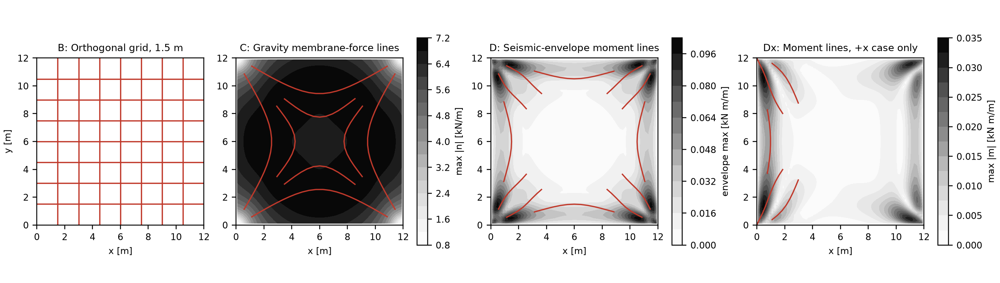
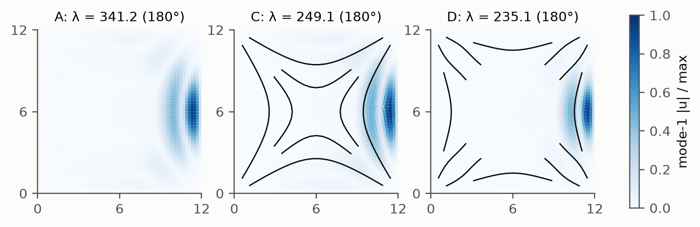

## Question

A thin concrete shell can be stiffened against buckling in two ways: with ribs, or with thicker concrete where it is needed. Ribs traced along stress lines are a common proposal. Do they recover the buckling capacity of an optimised thickness field when both use the same concrete, and so the same carbon?

## Approach

- **One shell, seven designs.** A form-found 12 × 12 m shell, rise 2.4 m, pinned edges, carries its self-weight plus a 0.2 g sway. The sway is applied in eight directions, every 45°. The score is the linear buckling factor in the worst direction. λ scales self-weight and sway together.
- **The designs.** A is a uniform 60 mm shell. B is an orthogonal rib grid, C follows gravity membrane-force lines, and D follows principal-moment lines of the sway envelope (12 lines). Dd is the eight-line diagonal trace of that same field. Dx follows the moment lines of the +x case only. Each of those sits on a 50 mm shell, and the rib depth is whatever the shared volume requires. E is a zoned thickness, bounds 40 to 150 mm, optimised with CMA-ES. The optimum uses 40 to 80.6 mm.
- **Tools.** CalculiX 2.23, S8R shells and B32R ribs offset below the shell. Gmsh meshes with a quality gate. Each ribbed design is exported as IFC4 (`IfcSlab` and `IfcMember`) and the layouts as DXF.
- **Fixed before the runs.** The hypothesis was written on 10 Nov 2026, before any result. D had to recover at least 70% of E's gain over A, and B and C had to recover clearly less.

## Findings in brief

The hypothesis is not supported. D is 31.10% below the plain shell, so it recovers none of E's gain. B is 16.05% above the plain shell and recovers 62.36% of that gain, which is more than D, not less. The rib layout matters, and the seismic-envelope tracing is not the layout that recovers the capacity. C is also below the plain shell. E, the symmetric thickness optimum, is 25.74% above the plain shell. A free search with 25 zones did not beat it.

The linear factors are in [the repository](https://github.com/syednafizreja/stress-line-ribs-shell-buckling). This page uses the comparisons, not a second copy of the table.

With a geometric imperfection the governing value is the weaker sign, and for A, C, D and E that value is a limit point. E's lead over A shrinks from 25.74% to 15.03%. D remains below A.

## Validation

The checks ran before the study results were used. Each has a script in the repository:

- the Scordelis-Lo roof, −0.16% on the finest mesh;
- a spherical cap against the classical Zoelly pressure, +0.86%;
- a ribbed slab against T-beam stiffness: thickened shell strips 0.999 of the reference, and the beam-rib model used in the study 0.976;
- mesh refinement from h = 0.4 m to 0.2 m: the uniform shell moves from 341.21 to 341.16 at 0°, and design D from 235.11 to 234.69;
- IFC4 round trip, six files, 0 schema errors, largest volume differences −0.11% and +0.10%.

## What this does not show

- The concrete is linear elastic and uncracked. Cracking, creep and reinforcement are not modelled. The nonlinear check is a geometric imperfection on that elastic model.
- One shell, one support case, and one lateral acceleration. The comparison here is a single volume, that of a uniform 60 mm shell.
- The edge-clearance rule drops ribs that lie along the pinned edge. That choice matters, because the governing mode uses the panel it leaves.
- Carbon is A1–A3 concrete only, so it is the same for every design by construction.
